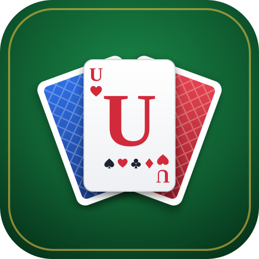
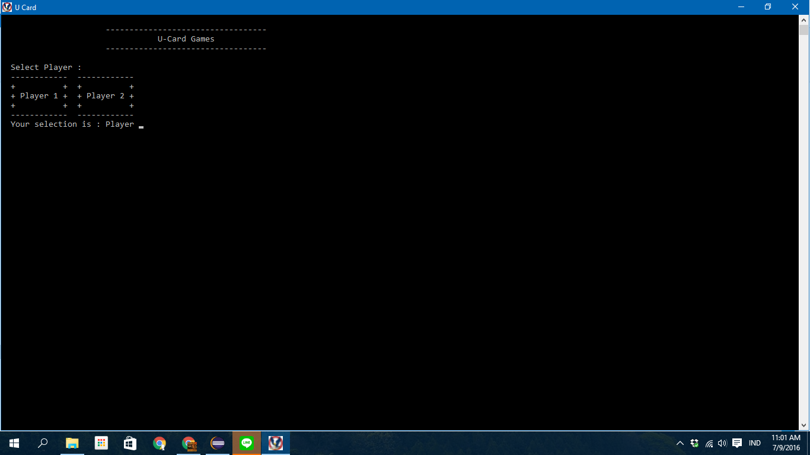
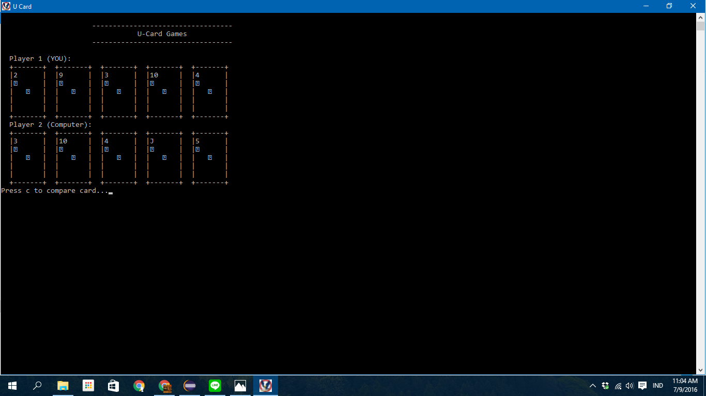
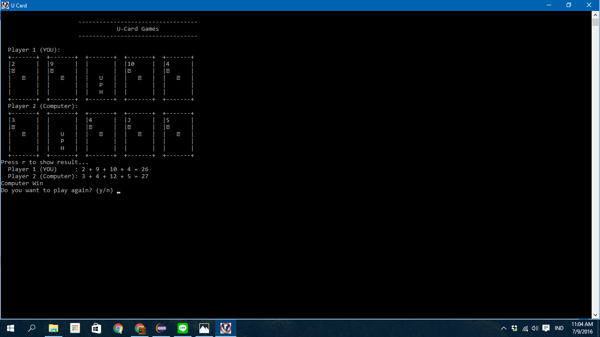

<p align="center">
  
</p>

<h1 align="center">U-Card</h1>

<p align="center">
  A simple console card game written in C++.<br>
  <a href="https://sudtanj.github.io/Card-Game/"><strong>▶ Play it in your browser</strong></a>: no download or install needed.
</p>

<p align="center">
  <a href="https://sudtanj.github.io/Card-Game/"></a>
  <a href="https://github.com/sudtanj/Card-Game/actions/workflows/pages.yml"></a>
  
</p>

U-Card was originally created for a student project and has since been released for learning, study, and further development.

## Features

- Two-player game against the computer
- Five-card hand comparison
- Console-based card display
- Keyboard-driven game flow
- Windows and Dev-C++ project configuration

## Requirements

- C++ compiler
- Windows operating system
- Dev-C++ (optional; the project includes Dev-C++ configuration files)

## Running the Game

1. Open the project from `cardgame/` in Dev-C++ or another compatible C++ IDE.
2. Build and run the project.
3. Select a player and follow the on-screen keyboard prompts.

The game uses Windows-specific console functions and therefore is intended to run on Windows.

## Play in the Browser

The live demo at **https://sudtanj.github.io/Card-Game/** runs the original `main.cpp`, compiled to WebAssembly with [Emscripten](https://emscripten.org/). The page is styled like the Windows console the game was written for. The game source is not changed. Instead, small shim headers in `web/shim/` replace the Windows-only `conio.h` and `windows.h` calls:

| Windows API          | Browser replacement                                  |
| -------------------- | ---------------------------------------------------- |
| `_getch()`           | Waits for a key press on the page (via Asyncify)     |
| `system("CLS")`      | Clears the on-page console                           |
| `SetConsole*()`      | No-ops                                               |
| Code page suit bytes | Rendered as ♥ ♦ ♣ ♠                                  |

The demo is rebuilt and deployed to GitHub Pages by `.github/workflows/pages.yml` on every push to `master`.

To build it locally (requires the [Emscripten SDK](https://emscripten.org/docs/getting_started/downloads.html)):

```bash
bash web/build.sh       # writes dist/index.html, dist/ucard.js, dist/ucard.wasm
cd dist && python3 -m http.server 8000
```

Then open http://localhost:8000.

## Game Flow

1. Choose a player.
2. Deal five cards.
3. Compare the lowest-ranked cards.
4. View the final score and result.
5. Play another round or quit.

## Project Structure

```text
assets/
└── logo.svg              # Project logo
cardgame/
└── Card GAme/
    ├── main.cpp          # Game source
    ├── UCard_private.h
    ├── Makefile.win
    └── Dev-C++ project files
web/
├── index.html            # Browser console page
├── build.sh              # Emscripten build script
└── shim/                 # conio.h / windows.h replacements for the browser
```

## Screenshots

| | |
| --- | --- |
|  |  |
|  |  |

## Planned Improvements

- Improve the card layout and console styling
- Add clearer menus, prompts, and status information
- Replace screen-clearing with a reusable UI function
- Improve input handling and keyboard flow
- Refactor the code into separate game, card, and UI modules
- Replace raw arrays with safer C++ containers
- Improve random-card generation and deck handling
- Add animations, sound effects, and a polished result screen

## License

See the [`LICENSE`](LICENSE) file for project licensing information.
